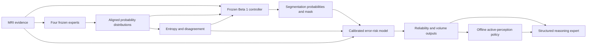

# CancerAgents Beta 2 research specification

## 1. Research goal

Beta 2 asks whether disagreement among four frozen segmentation experts can be
turned into a rigorous system for error prediction, reliability estimation,
anatomical uncertainty analysis, and selection of useful additional evidence.
It is an incremental research program in the same repository as Beta 1.

The system is research-only. It is not a diagnostic device, does not establish
clinical effectiveness, and must not autonomously order imaging or contact a
clinician.

## 2. Why uncertainty-aware multi-expert AI

Beta 1 reached 0.87344 mean Dice on its previously evaluated 130-case test set,
only 0.00032 above majority vote and 0.00499 above the best test expert. Some
controller HD95 values were worse than individual experts. Disagreement was
associated with errors, but association is neither a calibrated error
probability nor proof of independent information. Beta 2 therefore emphasizes
failure characterization rather than adding models for benchmark gain.

## 3. Scientific hypotheses

- H1: JS disagreement predicts frozen-controller voxel errors.
- H2: disagreement adds predictive value beyond individual/predictive entropy.
- H3: boundary evidence improves error prediction.
- H4: the controller allocates more mass to correct experts than incorrect
  experts when at least one is correct.
- H5: probability fusion repairs some hard-expert errors and causes others.
- H6: calibrated error-risk maps enrich actual errors in their highest-risk
  regions.
- H7: probabilistic WT/TC/ET volumes improve volume estimation, and interval
  coverage reveals the limits of the independence approximation.
- H8: feasible offline active-perception actions reduce uncertainty or error
  relative to cost and random/no-action baselines.
- H9: structured reasoning can reproduce evidence without inventing diagnoses,
  measurements, modalities, biology, or treatment.

All are unvalidated Beta 2 hypotheses.

## 4. Frozen Beta 1 architecture

- Four independent experts: CNN, Transformer, Boundary, and HighRes.
- Expert outputs: four-class probabilities, hard labels, entropy, confidence,
  margin, compact features, and availability.
- Frozen controller: 65 input channels, hidden width 8, four masked-softmax
  weights, and probability fusion.
- Separate LLM reasoning expert: structured evidence only; it cannot modify
  segmentation.
- Canonical case counts: 682 expert train, 248 controller train, 191
  validation, and 130 previously evaluated test.
- Baseline commit: `12eba663af858855fe82cd3ca804380fefd3d1ae`.
- Manifest: `docs/beta1/manifest.json`.

All five checkpoint hashes were locally verified against the manifest on
2026-10-12. The controller hash is
`86b604082a934a1d4f4a68467a88d16d268ae7653c552dcfc6c3087ba1d79fe2`.
The authoritative GitHub `main` points to the same commit. No Git tag or GitHub
release exists; the committed Beta 1 documentation is the release record.

## 5. Proposed Beta 2 architecture

Beta 2 analysis is additive. It does not alter Beta 1 inference by default.
Separate configs, output directories, checkpoints, and provenance are required.

## 6. Professor equations

The complete equation-by-equation audit, including required tensors, labels,
limitations, tests, and experiments, is in
[`equation_to_code.md`](equation_to_code.md). It covers:

- `p_k(v)`, `P(v)`, individual entropy, mean prediction, both JS forms;
- `E(v)`, conditional error probabilities, logistic `q(v)`, and `Q(v)`;
- controller weights, fusion, theoretical `w*(v)`, and trust metrics;
- Dice, HD95, volume, topology, and the composite loss;
- `X -> Z -> Y`, `I(Y;D|X)`, and `I(E;D|H,X)`;
- region segmentation probabilities and probabilistic volume moments;
- both active-perception objectives; and
- the structured-reasoning immutability constraint.

## 7. Symbol definitions

`X` is MRI evidence; `X_tilde` is a declared restricted MRI representation;
`P` is the set of expert probability distributions; `U/H` is uncertainty or
entropy; `D` is expert disagreement; `B` is boundary evidence; `Z` is the
feature/evidence state or conceptual latent variable; `Y` is true segmentation;
`E` is frozen-controller hard-label error; `w` is the gate simplex; `p_CA` is
the fused class distribution; `q` is calibrated error probability; `Q=1-q`;
and `S_T` is region-membership probability.

## 8. Mathematical assumptions

- Experts share class order and source voxel grid.
- Softmax vectors are normalized but not presumed calibrated.
- Availability is explicit. Missing experts are not silently replaced.
- When all experts are available, professor equations use equal weight `1/4`.
- Natural-log entropy and JS are normalized by `log(C)` only when a `[0,1]`
  map is requested.
- Subject observations are independent units for uncertainty intervals; voxels
  within a subject are correlated.
- True HD95 is an evaluation metric, not a differentiable training loss.
- Volume-variance independence is an approximation that omits spatial
  covariance.

## 9. Anatomical relevance

WT, TC, and ET remain the configured BraTS regions. Boundary evidence includes
the Boundary expert's predicted interface/distance features and separately
defined ground-truth or predicted morphological surfaces. These sources must
not be conflated. Physical distances and volumes require image spacing or
affine metadata. Region/boundary summaries are descriptive, not anatomical
diagnoses.

## 10. Biological relevance

The models describe MRI segmentation patterns. They do not observe tumor
histology, molecular subtype, treatment response, growth mechanism, or
unacquired modalities. No single-component or other topology constraint will
be imposed without evidence; gliomas can be multifocal. Biological claims must
remain limited to measured MRI-derived quantities.

## 11. Deep-learning and ML relevance

Beta 2 studies whether diversity among fixed inductive biases produces useful
error signals. The primary ML tasks are:

- distributional disagreement measurement;
- grouped and calibrated binary error prediction;
- observational gate-trust analysis;
- nonlocal loss-surrogate evaluation;
- controlled feature ablation rather than unqualified mutual-information
  claims; and
- offline cost-sensitive action selection.

## 12. Error predictor design

Stage B will build three regularized logistic baselines:

1. disagreement-only;
2. entropy-only; and
3. combined `D,H,B,X_tilde`.

Feature blocks and sampling weights will be versioned. Training data will be
streamed or sampled per subject with bounded memory. The model must preserve
the effective error prevalence or correct its intercept after sampling.
Evaluation includes AUROC, AUPRC, Brier score, log loss, calibration curves,
error enrichment, WT/TC/ET views, and boundary strata. Patient bootstrap or
subject-level aggregation supplies uncertainty; voxel-level IID confidence
intervals are prohibited.

## 13. Expert trust analysis

Implemented Stage A metrics are:

- total weight on available hard-correct experts;
- maximum-weight expert correctness;
- hard-expert oracle coverage and controller gap;
- all-experts-correct and all-experts-wrong fractions;
- probability-fusion correctness when no hard expert is correct;
- fusion recovery under partial expert failure;
- fusion harm despite a correct expert being available;
- per-expert weight/correctness correlations; and
- WT/TC/ET, boundary, and disagreement stratification.

These metrics are observational. Largest weight is not automatically
correctness, and gate weights are not causal explanations.

## 14. Calibration

Model fitting, calibration, and evaluation use disjoint subject groups.
Candidate calibration methods are Platt/logistic calibration for scalar scores
and isotonic regression only when sample support is sufficient. Method choice
must be fixed on development data. Reliability diagrams, expected/maximum
calibration errors, Brier score, and log loss will be reported. A map may be
called `Q(v)` only after calibration; otherwise it is labeled an uncalibrated
risk/reliability score.

## 15. Information theory

The original conditional-information equations are retained. If all experts
and `D` are deterministic functions of complete `X`, then conditioning on
complete `X` makes `I(Y;D|X)=0`; similarly, conditioning on variables that
determine `D` can make `I(E;D|H,X)=0`. Beta 2 will first test incremental
predictive value relative to a declared `X_tilde` and fixed model class.
Exact CMI will not be claimed from an ablation score.

## 16. Loss formulations

The proposed global loss is

`L=lambda_1 L_Dice + lambda_2 L_HD95_surrogate +
lambda_3 L_volume + lambda_4 L_topology_surrogate`.

The true HD95 implementation remains evaluation-only. The HD95 surrogate,
topology definition, region reductions, units, and lambdas must be preregistered.
Dice, surface, volume, and topology couple voxels, so minimizing this global
loss is not identical to independently solving the professor's voxel-local
`w*(v)` equation. No retraining starts without explicit approval and separate
Beta 2 checkpoints.

## 17. Tumor volume

For each WT/TC/ET region, Stage C will report:

- expected soft volume in mL;
- hard-mask volume in mL;
- reference volume and bias/error when labels exist;
- covariance-free variance approximation with an explicit warning; and
- empirical interval coverage.

Voxel volume comes from spacing/affine in mm cubed and is converted to mL by
division by 1000. The approximation is not an exact posterior interval.

## 18. Active perception

The registry will represent higher-resolution processing, alternate crop,
different expert, additional modality, and MD review. Each action carries:

- feasibility and reason;
- required existing evidence;
- computational/storage/human cost;
- expected uncertainty/error change;
- provenance of the outcome estimate; and
- whether it is executable or recommendation-only.

No action can invent acquisition detail, a missing modality, or independence
from rerunning an identical deterministic model. MD review is a recommendation
for human review, not a clinical decision. Initial studies are offline only,
against random and no-action baselines, with explicit stop/abstain behavior.

## 19. Experiment matrix

- Q1/Q2: JS versus entropy for voxel error; logistic baselines and patient
  bootstrap.
- Q3: add boundary block to the combined model.
- Q4-Q6: controller trust, fusion fix/harm, and all-wrong analyses.
- Q7/Q8: calibration and top-risk enrichment.
- Q9: probabilistic volume error and interval coverage.
- Q10: isolated Dice/surface/volume/topology ablations using new checkpoints.
- Q11: action utility versus random/no action.
- Q12: structured-evidence factuality and unsupported-claim tests.
- Q13: Beta 2 utility against CNN, Transformer, Boundary, HighRes, majority
  vote, and frozen controller.

Negative results and multiplicity are reported. Engineering completion is not
experimental validation.

## 20. Dataset partitioning and leakage

The original test set is already exposed and is not a new Beta 2 test. It will
not fit, calibrate, tune, or select Beta 2 models. `expert_train` predictions are
in-sample for experts; `controller_train` predictions are in-sample for the
gate. The validation set was used to select Beta 1 checkpoints and has already
supported exploratory analysis.

The defensible near-term plan is exploratory subject-grouped cross-fitting
inside validation:

- freeze all Beta 1 models and all Beta 2 feature definitions first;
- assign subjects, not voxels/cases, to error-model fit, calibration, and
  evaluation folds;
- keep repeated scans from one subject together;
- aggregate fold-held-out predictions only; and
- clearly state that underlying Beta 1 checkpoint selection used validation.

This supports exploratory error-model evidence, not definitive independent
generalization. A new external or untouched cohort is required for confirmatory
Beta 2 claims. Historical split manifests are immutable.

## 21. Limitations

- No untouched Beta 2 test cohort currently exists.
- Beta 1 gain over vote/best expert is small.
- HighRes is weaker and has proposal-limited fusion coverage.
- Shared expert failure can produce low disagreement and high error.
- Calibration can shift by scanner/site/prevalence.
- Voxel correlation invalidates naive sample-size arguments.
- Weight analysis is associative, not causal.
- The volume variance omits spatial covariance.
- Active-action outcome models may be misspecified.
- Reasoning safeguards do not prove clinical factuality.

## 22. Compute and storage estimates

Stage A code/tests require negligible artifact storage and run on CPU.

Before Stage B real-data work, inventory existing validation probability maps.
Compact metric summaries are insufficient for voxel modeling. A bounded design
should process one case at a time, retain sampled feature/target rows or
compressed per-case chunks, and checkpoint atomically.

Preliminary planning range, to be measured before execution:

- code/synthetic tests: under 5 minutes, under 1 GiB RAM, negligible disk;
- streaming feature extraction from existing voxel probabilities: potentially
  4-12 hours on one MPS job, roughly 4-10 GiB peak host memory, and
  0.2-1.0 GiB for sampled/chunked tabular features;
- rerunning all four experts on 191 validation cases: likely over 30 minutes
  and therefore requires explicit approval after a measured pilot.

No estimate authorizes execution. Any projection over 30 minutes or 1 GiB of
new data must be approved first.

## 23. Reproducibility

- Branch: `research/uncertainty-active-perception`.
- Frozen baseline commit and checkpoint hashes are recorded above.
- Beta 2 outputs use separate directories.
- Every artifact must store code commit, source checkpoint hashes, split hash,
  subject IDs/roles, feature schema, seed, sampling policy, calibration method,
  and completion state.
- Writes must be resumable and atomic.
- MRI, raw patient data, checkpoints, and large tensors remain gitignored.
- Kingston is not required for source, docs, synthetic tests, or lightweight
  analysis. The mandated stop/notification applies before any operation that
  truly needs it.

## 24. Implementation status

### Implemented and tested

- Beta 1 probability outputs and masked controller fusion.
- Beta 2 probability/simplex/grid/availability validation.
- Separate individual entropy and mean predictive entropy.
- Explicit weighted-KL JS and entropy-identity JS with residual.
- Probability variance, vote disagreement, pairwise reuse, and generic
  region/boundary summaries.
- Controller trust/oracle/fusion fix-harm metrics.
- Synthetic mathematical and frozen-manifest integrity tests.

### Implemented in Beta 1 and reused

- Four expert models, controller, sliding inference, disagreement, error maps,
  pairwise analysis, subject split guards, physical HD95 evaluation, and
  structured reasoning immutability.

### Proposed

- Error model, calibration, reliability exports, probabilistic volume,
  anatomical loss surrogates, conditional-information ablations, active
  perception, and expanded reasoning schema.

### Blocked

- Definitive independent Beta 2 generalization without a new untouched cohort.
- Any biological topology prior until it is operationally justified.
- Real-data experiments pending resource inventory and user approval.

### Experimentally evaluated

- No new Beta 2 method yet. Beta 1 results remain the only frozen evaluation.

## 25. Next scientific milestones

1. Inventory whether existing validation artifacts contain per-voxel fused and
   expert probabilities, weights, MRI features, and labels.
2. Freeze a subject-grouped exploratory fold manifest.
3. Build a streamed sampled-voxel dataset with explicit prevalence metadata.
4. Fit disagreement-only and entropy-only logistic baselines.
5. Add boundary and restricted MRI features.
6. Calibrate on separate subjects and evaluate held-out subjects.
7. Only then implement `S,Q` exports and probabilistic volume analysis.
8. Defer expensive loss/active-perception experiments until the preceding
   evidence and resource estimates are reviewed.
